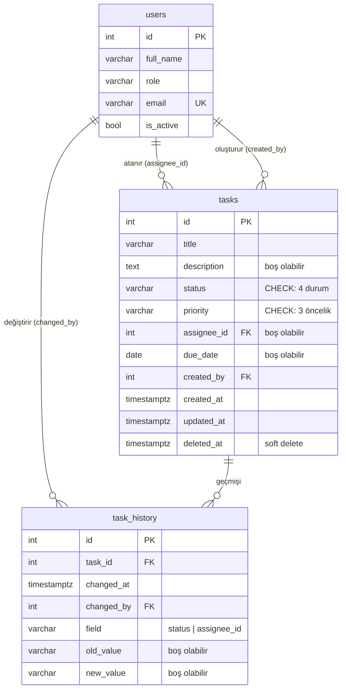

# Plan: Veri modeli + migration + seed

> Durum: **onaylandı** (07.11.2026).

## 1. Tablolar



### `users`
| Sütun | Tip | Kural |
|---|---|---|
| id | int PK | CSV'deki id korunur |
| full_name | varchar(100) | zorunlu |
| role | varchar(50) | zorunlu |
| email | varchar(255) | zorunlu, tekil |
| is_active | bool | varsayılan `true` |

### `tasks`
| Sütun | Tip | Kural |
|---|---|---|
| id | int PK | CSV'deki id korunur, yeni görevler sıradan devam eder |
| title | varchar(200) | zorunlu, boş olamaz (DB'de `CHECK`) |
| description | text | boş olabilir |
| status | varchar(20) | `CHECK`: Yapılacak / Devam ediyor / Beklemede / Bitti. **index** |
| priority | varchar(10) | `CHECK`: Yüksek / Orta / Düşük |
| assignee_id | int FK → users | boş olabilir (atanmamış). **index** |
| due_date | date | boş olabilir. **index** |
| created_by | int FK → users | zorunlu |
| created_at | timestamptz | UTC |
| updated_at | timestamptz | her güncellemede yenilenir |
| deleted_at | timestamptz | dolu ise görev silinmiş sayılır |

### `task_history` (audit log)
| Sütun | Tip | Kural |
|---|---|---|
| id | int PK | |
| task_id | int FK → tasks | **index** (detay sayfasında görev bazında okunur) |
| changed_at | timestamptz | UTC |
| changed_by | int FK → users | "kim" (API'de `actor_id`'den gelir) |
| field | varchar(20) | `CHECK`: `status` ya da `assignee_id` |
| old_value / new_value | varchar(50) | metin olarak saklanır; ilk atamada `old_value` boştur |

**Neden bu şekilde?**
- **Durum ve öncelik için `CHECK` kısıtlı metin, Postgres `ENUM` değil.** ENUM'a değer eklemek ayrı bir migration ister; CHECK hem basit hem okunur. Python tarafında aynı değerler `StrEnum` olarak tanımlanır.
- **Geçmişte değerler metin.** Tek tablo hem durum hem atama değişikliğini tutar. CSV'deki yapıyla birebir aynı.
- **Görev oluşturulurken atanan kişi varsa geçmişe "ilk atama" kaydı yazılır** (`old_value` boş). Veride de böyle bir örnek var (geçmiş kaydı 34). Oluşturma zamanının kendisi `created_at`'ten okunur.

## 2. Veri sorunları ve kararlar

Kaynak: `dataset/*.csv`. Seed script bu kararları uygular ve sonunda bir rapor basar.

| # | Sorun | Ham veri (CSV) | Karar | Sonuç |
|---|---|---|---|---|
| 1 | Durumda boşluk / büyük harf farkı | `18,...,Devam Ediyor ,...`<br>`19,...,bitti,...` | **Düzelt.** Boşluk silinir, büyük/küçük harf fark etmeden eşlenir | `Devam ediyor`, `Bitti` |
| 2 | Dokümanda olmayan durum | `7,...,Beklemede,...`<br>`20,...,Beklemede,...` | **Koru** (4. durum) | `Beklemede` |
| 3 | Farklı tarih formatı | `24,...,17.11.2026,...`<br>`29,...,07.11.2026,...` | **Düzelt.** `GG.AA.YYYY` da okunur | `2026-11-17`, `2026-11-07` |
| 4 | Boş son tarih | `13,...,4,,2,...`<br>`26,...,8,,1,...`<br>`37,...,4,,4,...` | **Boş bırak** (son tarih zorunlu değil) | `due_date = NULL` |
| 5 | Boş öncelik | `13,Ana şalter termal kamera ölçümü,,Yapılacak,,4,...` | **Varsayılan ata** | `Orta` |
| 6 | Boş başlık | `37,,"RT-04 nacelle içinde yağ izi var, bakılacak.",...` | **Açıklamadan türet** (ilk cümle, en fazla 80 karakter) | `RT-04 nacelle içinde yağ izi var, bakılacak` |
| 7 | Olmayan kişiye atama | `32,RT-09 jeneratör rulman değişimi planla,...,12,...` (users'ta 12 yok) | **Atanmamış yap**, raporda işaretle | `assignee_id = NULL` |
| 8 | Atanmamış görev | `42,RT-12 kanat açısı sensörü kontrolü,...,Yüksek,,2026-11-11,...` | **Olduğu gibi** (atanmamış görev geçerli) | `assignee_id = NULL` |
| 9 | Pasif kişiye atanmış görevler | `15,...,9,...` ve `35,...,9,...` (Okan Kurt, `is_active=false`) | **Koru.** Mevcut atama kalır, yeni atama yapılamaz | değişmez |
| 10 | Mükerrer görev | `30,Trafo yağ numunesi (yıllık),...,06:00:00Z`<br>`31,Trafo yağ numunesi (yıllık),...,06:02:00Z` | **Atla.** Başlık, açıklama, kişi ve tarih aynı, 2 dk arayla girilmiş; ilki tutulur | 31 eklenmez |
| 11 | Geçmişte olmayan göreve kayıt | `34,43,...,assignee_id,,5`<br>`38,43,...,status,Yapılacak,Devam ediyor` | **Atla** (görev 43 yok) | 2 kayıt eklenmez |
| 12 | Geçmiş ile güncel durum çelişiyor | geçmiş `52,40,...,Devam ediyor,Bitti`, ama `tasks.csv`'de görev 40 `Devam ediyor` | **tasks.csv'yi esas al** (export anındaki güncel durum). Geçmiş olduğu gibi kalır, raporda işaretlenir | görev 40 = `Devam ediyor` |
| 13 | Çok satırlı açıklama | görev 35'in açıklaması tırnak içinde 2 satır | **Olduğu gibi.** Python `csv` modülü bunu doğru okur | satır sonu korunur |

**Seed'in bilerek uygulamadığı kurallar:** Geçmiş kayıtları durum geçiş kuralına göre kontrol edilmez; bunlar gerçekte yaşanmış olaylar. Geçmiş tarihli son tarihler de kabul edilir. Bu kurallar sadece API üzerinden yapılan yeni işlemlerde geçerli.

**Beklenen sayılar:** 9 kişi, 41 görev (42 − 1 mükerrer), 53 geçmiş kaydı (55 − 2).

## 3. Seed script'in akışı (`backend/scripts/seed.py`)

1. DB'de kişi varsa "zaten dolu" yazar ve çıkar. Bu sayede her `docker compose up`'ta güvenle çalışabilir.
2. `users.csv` okunur ve eklenir.
3. `tasks.csv` satır satır temizlenir: 1–10 numaralı kararlar uygulanır.
4. `task_history.csv` okunur. Durum değerleri aynı şekilde düzeltilir, görevi olmayan kayıtlar atlanır.
5. Id'ler CSV'den geldiği için Postgres sayaçları (sequence) en büyük id'ye ayarlanır. Böylece yeni görev 43'ten başlar.
6. Hepsi **tek transaction** içinde yazılır; hata olursa hiçbir şey yazılmaz.
7. Sonunda kısa bir rapor basılır. Örnek:
   ```
   users: 9 eklendi
   tasks: 41 eklendi, 1 atlandı (31: mükerrer)
     - 13: öncelik boş -> Orta
     - 32: assignee 12 yok -> atanmamış
     ...
   task_history: 53 eklendi, 2 atlandı (görev 43 yok)
   ```

Temizleme fonksiyonları (`parse_date`, `normalize_status` gibi) ayrı ve küçük fonksiyonlar olarak yazılır, her biri için birim testi olur.

## 4. Çalıştırma

- **Local (docker):** backend container'ı açılırken sırayla `alembic upgrade head` → `python -m scripts.seed` → `uvicorn` çalışır. Böylece `docker compose up` ile veri dolu gelir.
- **Prod (Neon):** app açılışında hiçbiri çalışmaz. Local'den, prod `DATABASE_URL` ile bir kez elle çalıştırılır.

## 5. Oluşacak dosyalar ve commit'ler

| Commit | Dosyalar |
|---|---|
| `feat: veri modeli ve ilk migration eklendi` | `app/db.py` (engine, `NullPool`, session), `app/models.py` (User, Task, TaskHistory, enum'lar), `alembic.ini`, `alembic/env.py`, `alembic/versions/0001_*.py` |
| `feat: CSV seed script'i eklendi` | `scripts/seed.py`, `tests/test_seed_cleaning.py` |
| `feat: docker'da migration ve seed otomatik çalışıyor` | `backend/Dockerfile` (başlangıç komutu) |
